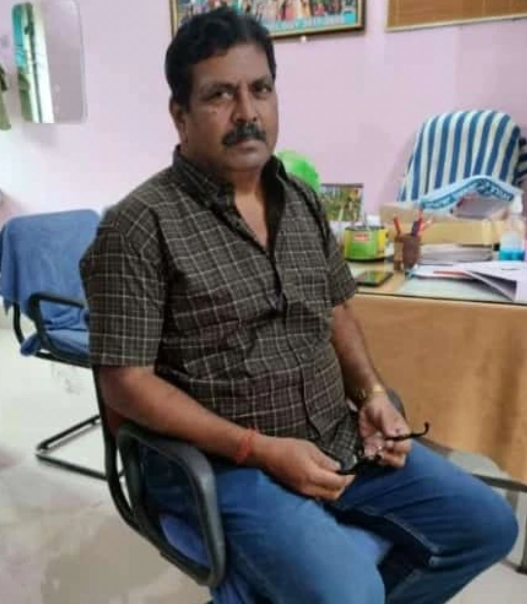
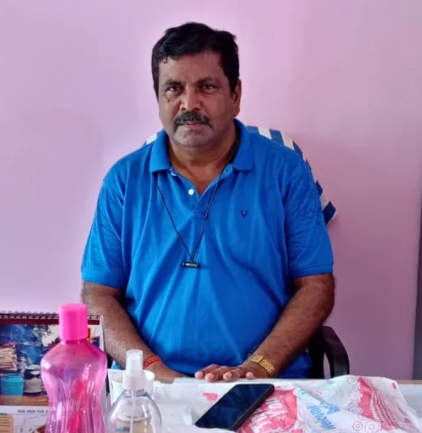
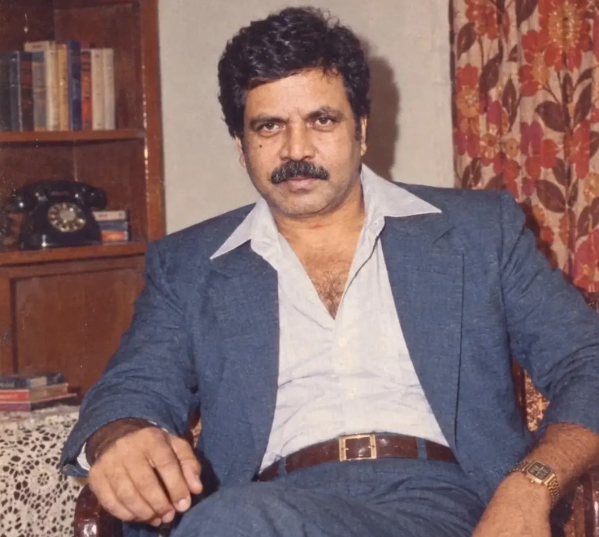

# Happy-Birthday-Sirr

<!DOCTYPE html>
<html lang="en">
<head>
<meta charset="UTF-8">
<meta name="viewport" content="width=device-width, initial-scale=1.0">
<meta name="theme-color" content="#090807">
<title>A Birthday Surprise for Sir</title>

</head>

<body>

<!-- MUSIC AT THE TOP -->

  

    
♫

    

      <strong>A LITTLE MUSIC FOR THIS SPECIAL DAY</strong>
      One song • One special celebration
    

    

      <i></i><i></i><i></i><i></i>
    

    <button id="musicBtn" onclick="toggleMusic()">▶ PLAY</button>
  

<audio id="birthdayMusic" loop preload="auto">
  <source src="SONG.mp3" type="audio/mpeg">
</audio>

<!-- HERO -->
<header class="hero" id="home">
  

    
A SPECIAL DAY • A SPECIAL PERSON

    <h1>A LITTLE</h1>
    <h2>Birthday Surprise</h2>

    

    

      Some people make ordinary moments 
      become beautiful memories.
    

    <button class="primary-btn" onclick="document.getElementById('welcome').scrollIntoView({behavior:'smooth'})">
      DISCOVER YOUR SURPRISE &nbsp; ↓
    </button>
  

</header>

<!-- WELCOME -->
<section class="section reveal" id="welcome">
  
A small gesture from the heart

  <h2 class="section-title">For You, Sir.</h2>

  

    

      Not every special occasion needs grand celebrations.
      Sometimes, a few genuine words, a little effort,
      and a heartfelt wish are enough.
        
      <strong>This little corner of the internet is made especially for you, Sir.</strong>
        
      With respect, gratitude and warm wishes.
    

  

</section>

<!-- FOUR PHOTOS -->
<section class="section reveal" id="memories">
  
A collection of moments

  <h2 class="section-title">Beautiful Memories</h2>
  

    Every photograph holds a moment.
    Every moment has a story.
  

  

    

      
    

    

      
    

    

      
    

    

      
    

  

</section>

<!-- PERSONAL MESSAGE -->
<section class="section reveal">
  
A few words from my heart

  <h2 class="section-title">Dear Sir,</h2>

  

    

      Today, I just want to take a moment to wish you
      a very Happy Birthday.
    

    

      Thank you for sharing your knowledge, for your
      guidance, and for being someone whose presence
      makes a difference.
    

    

      There are many things a student learns in college,
      but some lessons and memories stay with us
      long after the classroom days are over.
    

    

      I sincerely wish you happiness, good health,
      peace and success in every chapter of life.
    

    

      You deserve all the wonderful things life has to offer.
    

  

</section>

<!-- GRATITUDE -->
<section class="section reveal">
  
A little appreciation

  <h2 class="section-title">With Respect & Gratitude</h2>

  

    Some qualities deserve appreciation, not just on birthdays,
    but every single day.
  

  

    

      
✧

      <h3>Guidance</h3>
      
For the knowledge and direction that help students grow.

    

    

      
◇

      <h3>Wisdom</h3>
      
For lessons that go beyond textbooks and classrooms.

    

    

      
♡

      <h3>Kindness</h3>
      
For the little things that make a lasting difference.

    

    

      
✦

      <h3>Inspiration</h3>
      
For reminding students that learning never stops.

    

    

      
∞

      <h3>Memories</h3>
      
For moments that will remain special in the years ahead.

    

    

      
✧

      <h3>Respect</h3>
      
For being someone who deserves genuine appreciation.

    

  

</section>

<!-- QUOTE -->
<section class="quote-section section reveal">
  
A thought to remember

  

    "A great teacher doesn't just teach lessons,
    but leaves a positive mark
    on the hearts and minds of students."
  

</section>

<!-- GIFT SURPRISE -->
<section class="section reveal">
  
Something special awaits

  <h2 class="section-title">A Little Surprise</h2>

  

    Sir, I have kept a little something for you.
    Please open this gift.
  

  

    

    

    

  

  

    TAP TO OPEN YOUR GIFT
  

  

    
A gift that comes from the heart

    

      If I could gift you something today,
      it would be endless happiness,
      excellent health, beautiful memories,
      and countless reasons to smile.
        
      May every new day bring something
      wonderful into your life.
        
      You deserve the very best, Sir.
    

  

</section>

<!-- SECRET LETTER -->
<section class="section reveal">
  
One last little message

  <h2 class="section-title">A Letter For You</h2>

  

    Before you leave, there is one more thing
    I would like to say.
  

  

  

    TAP TO OPEN THE LETTER
  

  

    <h3>Dear Sir,</h3>
    

      I may not always express it in words,
      but I genuinely appreciate the opportunity
      to learn from you.
        
      Years may pass, college days may become
      memories, but the respect we have for
      good teachers remains.
        
      Thank you for being a part of my journey.
        
      Wishing you a beautiful birthday and
      an even more beautiful year ahead.
        
      With sincere respect, 
      <strong>Biraja</strong>
    

  

</section>

<!-- FINAL BIRTHDAY -->
<section class="section final-section reveal" id="final">
  

    
A wish from the heart

    <h2>Happy Birthday, Sir!</h2>

    

    

      Some teachers teach lessons. 
      Some leave memories. 
      And some become a beautiful part
      of our journey.
        
      Thank you for being one of them.
    

    

      May your life always be filled with
      happiness, good health, peace and success.
    

    

      WITH SINCERE RESPECT & GRATITUDE
      <strong>Biraja</strong>
      One of your students.
    

    <button class="primary-btn" onclick="celebrate()">
      ✦ CELEBRATE AGAIN ✦
    </button>

  

</section>

<footer>
  MADE WITH RESPECT, GRATITUDE & HEARTFELT WISHES
    
  A LITTLE BIRTHDAY GIFT BY BIRAJA
</footer>

<!-- PHOTO LIGHTBOX -->

  <button class="close-lightbox" onclick="closePhoto()">×</button>
  

</body>
</html>
